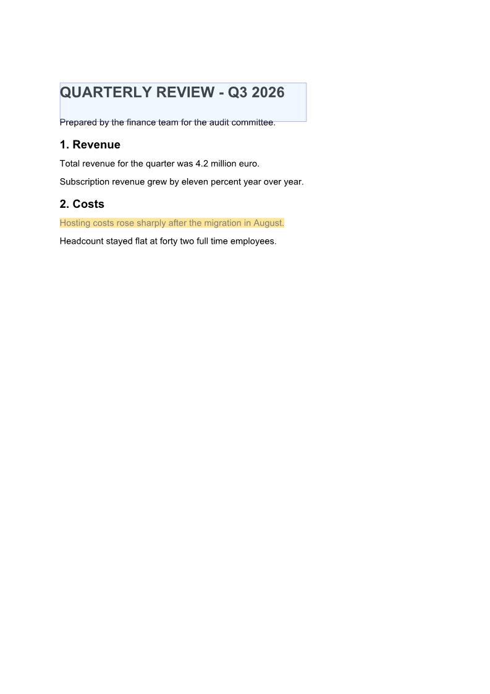

# Annotate PDF in C# — highlight, comment, reply, extract

[](https://github.com/groupdocs-annotation/annotate-pdf-csharp-net/actions/workflows/build.yml)
[](https://www.nuget.org/packages/GroupDocs.Annotation/)
[](https://dotnet.microsoft.com/)
[](LICENSE)

The shortest honest answer to *"how do I annotate a PDF in C#?"* — a console application that
highlights text, draws a box, attaches a comment with a reply thread, reads the markup back out and
renders page images. It runs on Windows and Linux, with no Adobe Acrobat and no Microsoft Office
installed, and the same calls work on **DOCX, XLSX, PPTX and images** as well as PDF.

```bash
dotnet run --project src/AnnotatePdf -- highlight samples/quarterly-review.pdf --text "Hosting costs"
```



## Read this with

| Resource | What it adds |
|---|---|
| [Blog: How to annotate a PDF in C# — the 2026 edition](https://blog.groupdocs.com/annotation/how-to-annotate-pdf-in-csharp/) | the walk-through, with what changed since the 2021 posts |
| [Docs: Annotate a PDF in C#](https://docs.groupdocs.com/annotation/net/annotate-pdf-in-csharp/) | the step-by-step reference page |
| [This repository](https://github.com/groupdocs-annotation/annotate-pdf-csharp-net) | the code that runs |

## Quick start

Requires the [.NET SDK 8.0 or later](https://dotnet.microsoft.com/download).

```bash
git clone https://github.com/groupdocs-annotation/annotate-pdf-csharp-net.git
cd annotate-pdf-csharp-net

dotnet run --project src/AnnotatePdf -- info samples/quarterly-review.pdf
dotnet run --project src/AnnotatePdf -- highlight samples/quarterly-review.pdf --text "Hosting costs" --message "Check this against the invoice"
dotnet run --project src/AnnotatePdf -- list output/quarterly-review.annotated.pdf
dotnet run --project src/AnnotatePdf -- preview output/quarterly-review.annotated.pdf
```

The first command prints what GroupDocs.Annotation sees — file type, page count, page size and how
many text lines it found per page. The rest add markup, read it back and render PNGs of the pages.

## Commands

| Command | What it does |
|---|---|
| `info <document>` | file type, pages, page size, text lines per page |
| `highlight <document> --text "phrase"` | finds the phrase and highlights every line it appears on |
| `highlight <document> --page 0 --x --y --width --height` | highlights an explicit rectangle |
| `area <document> --page 0 --x --y --width --height` | draws a box around a region |
| `list <document>` | prints annotations, authors and replies |
| `remove <document> [--id N]` | removes one annotation, or all of them |
| `preview <document> [--no-annotations]` | renders page images as PNG |

Every command takes `--out` to choose where the result goes; the default is `output/`.

## The five calls that matter

Everything the sample does lives in [`Annotations.cs`](src/AnnotatePdf/Annotations.cs).

**Add a highlight with a reply.**

```csharp
using (Annotator annotator = new Annotator("input.pdf"))
{
    annotator.Add(new HighlightAnnotation
    {
        PageNumber = 0,                       // 0 = first page
        BackgroundColor = 0xFFE699,           // 0xRRGGBB
        Opacity = 0.5,
        Message = "Check this figure",
        User = new User { Id = 1, Name = "Reviewer", Role = Role.Editor },
        Points = new List<Point>              // top-left, top-right, bottom-left, bottom-right
        {
            new Point(72, 664), new Point(312, 664),
            new Point(72, 650), new Point(312, 650)
        },
        Replies = new List<Reply>
        {
            new Reply { Comment = "Confirmed with finance.", RepliedOn = DateTime.Now }
        }
    });

    annotator.Save("result.pdf");
}
```

**Read the markup back.**

```csharp
using (Annotator annotator = new Annotator("result.pdf"))
    foreach (AnnotationBase a in annotator.Get())
        Console.WriteLine($"#{a.Id} {a.Type} page {a.PageNumber + 1}: {a.Message}");
```

**Find text instead of measuring coordinates.** `GetDocumentInfo()` hands back the text lines of
every page with their boxes, so the phrase can be located instead of guessed:

```csharp
IDocumentInfo info = annotator.Document.GetDocumentInfo();
foreach (PageInfo page in info.PagesInfo)
    foreach (TextLineInfo line in page.TextLines)
        if (line.Text.Contains(phrase))
            ...   // see HighlightText() for the conversion
```

**Remove** with `annotator.Remove(id)` and **render** with `annotator.Document.GeneratePreview(...)`.

### Two conventions that catch everybody

| | Origin | Page numbering |
|---|---|---|
| `PageInfo` / `TextLineInfo` | top-left | `PageNumber` is **1-based** |
| `AreaAnnotation.Box` | top-left | — |
| `HighlightAnnotation.Points` and other text markup | **bottom-left** | `PageNumber` is **0-based** |
| `PreviewOptions.PageNumbers` | — | **1-based** |

A line at `TopIndent = t` with height `h` is therefore `pageHeight - t - h` … `pageHeight - t` in a
highlight, and the page index is `PageInfo.PageNumber - 1`. An annotation addressed to a page that
does not exist is dropped without an exception — if markup "did not appear", check the page index
first.

## Linux

```bash
docker build -t annotate-pdf .
docker run --rm annotate-pdf info samples/quarterly-review.pdf
docker run --rm -v "$PWD/output:/work/output" annotate-pdf highlight samples/quarterly-review.pdf --text "Hosting costs"
```

The [Dockerfile](Dockerfile) installs `fontconfig` and `fonts-liberation`: the .NET runtime image
ships without fonts, and text rendering needs them.

## Licensing

Without a licence the library runs in evaluation mode and the output carries evaluation marks.
Set `GROUPDOCS_ANNOTATION_LICENSE` to the path of a `.lic` file to remove them —
[temporary licence](https://purchase.groupdocs.com/temporary-license).

## Related samples

* [ai-document-review-annotations-net](https://github.com/groupdocs-annotation/ai-document-review-annotations-net) —
  the same annotations, written from a model's findings
* [browser-annotation-ui-net](https://github.com/groupdocs-annotation/browser-annotation-ui-net) —
  drawing and answering them in a browser
* [GroupDocs.Annotation-for-.NET](https://github.com/groupdocs-annotation/GroupDocs.Annotation-for-.NET) —
  the full example set, one file per annotation type

## License

MIT, see [LICENSE](LICENSE). GroupDocs.Annotation itself is a commercial library with its own
[licence terms](https://purchase.groupdocs.com/policies/).
